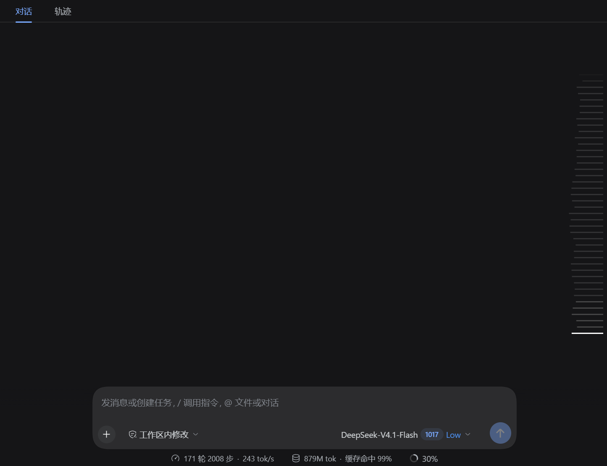
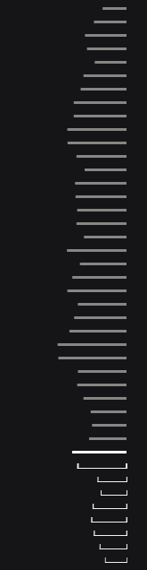
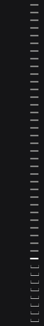
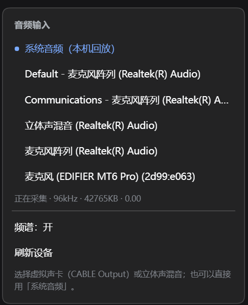

# dsh-spectrum-rail

把 DeepSeek Harness 对话右侧的**轮次导航条**画成一条音频频谱：条的长度跟着电脑里正在播放的声音跳，位置、滚轮、悬停预览、点击跳转全部保持原生。



| 深色主题（已提亮） | 浅色主题 | 右键菜单 |
|---|---|---|
|   |   |  |

> 深色主题的两张是同一张截图的**提亮版**（条的颜色按 2.4× 对比度放大），只为在深色页面上看清；
> 未处理的原始截图见 [rail-a.png](docs/rail-a.png) / [rail-b.png](docs/rail-b.png)。浅色主题两张为原始截图。

## 特性

- **42 段对数频谱**（40 Hz – 16 kHz），底部是最低频
- 长度由音频 FFT 驱动，最大 60px（原生小条的 3 倍）
- 轮次不足 42 条时，下方用「1px 下边 + 2px 端帽」的托盘占位补足，并且同样跟着音乐动
- 条粗细、颜色、透明度与原生一致：已加载 `border-l4`、未加载 0.6、悬停 `label-tertiary`、当前轮白色
- **右键菜单**：选输入设备、开关频谱、刷新设备
- 原生交互零改动：滚轮滚轨道、悬停出预览卡、点击跳转、键盘操作都由 DSH 自己处理

## 安装

要求：**Windows 10/11**（系统音频部分）、DSH `0.2.0` 及以上、.NET Framework 4.x（Windows 自带）。

### 方式一：本地目录

```bash
git clone https://github.com/Microqian2th/dsh-spectrum-rail.git
dsh plugin --profile <profile> add ./dsh-spectrum-rail
```

或在 DSH 的插件页用「安装本地目录」选择该文件夹。

### 方式二：Release 包

从 Releases 下载 `dsh-spectrum-rail-<version>.zip`，解压后在插件页安装该目录。

安装后**重启一次 DSH**（Host 半需要重新加载才能拉起音频助手）。

## 使用

在导航条上**右键**：

| 菜单项 | 作用 |
|---|---|
| 系统音频（本机回放） | 用 WASAPI 回环直接采电脑正在播放的声音，不需要虚拟声卡 |
| 麦克风 / 虚拟声卡 | 走浏览器 `getUserMedia`，适合 VB-Cable、立体声混音等 |
| 频谱：开 / 关 | 关 = 退回原装外观 + 停止采集 + 记住状态 |
| 刷新设备 | 重新枚举输入设备 |

> 只有 Windows 才有「系统音频」这一项；其它平台请用麦克风或虚拟声卡。

### 状态行

选择设备后，菜单里会显示 `正在采集 · 96kHz · 已收 KB · 峰值`，用来判断是"没数据"还是"没动画"。

## 原理

```
loopback-capture.exe   WASAPI 回环（默认输出设备，共享模式）
        │  原始 PCM（float32 交织）
        ▼
127.0.0.1:45999        本地 HTTP 流（仅本机）
        ▼
Client 插件            fetch → AudioBuffer 排队 → 双分析器
                       · 8192 点长窗：低频分得开
                       · 2048 点短窗：中高频跟手
```

Client 侧只覆盖原生导航条每条按钮的 `::before`，**不接管任何交互**；找不到结构时静默不生效（fail-open）。

## 已知限制

- **系统音频仅 Windows**，且只采**默认输出设备**；换默认设备后需要重选一次
- 正文栏可用宽度 ≤ 900px 时，DSH 原生就会隐藏整条导航条，插件也随之不显示
- 单轮会话没有导航条（`items.length < 2`），所以没有频谱
- 未加载轮次的识别依赖 `aria-label` 的中英文文案，其它语言下会退化成"已加载"的样式
- 依赖 DSH 自带导航条的 DOM 结构（`button[data-index]` + `::before`），**DSH 大版本升级可能失效**
- 本地助手端口 `45999–46010` **没有鉴权**，仅绑定 `127.0.0.1`；同一台机器上的其它程序可以读到系统音频

## 隐私

- 只有在你显式选择设备后才开始采集
- 关闭「频谱」立即停止采集并释放设备
- 音频不落盘、不上传，只在页面内存里做 FFT

## 卸载

```bash
dsh plugin --profile <profile> remove dsh-spectrum-rail
```

或在插件页停用/移除。移除后导航条恢复原样（插件卸载时会撤掉注入的样式）。

## 开发

```
client.js                 浏览器端：绘制、音频、菜单
index.js                  Host 端：拉起/守护回环助手
native/LoopbackCapture.cs WASAPI 回环 + 本地 HTTP 流
native/build.ps1          重新编译 exe（csc）
tests/                    手工联调脚本（流、并发、首字节延迟）
```

重新编译助手：

```powershell
powershell -ExecutionPolicy Bypass -File native/build.ps1
```

## License

[MIT](LICENSE)

---

## English

**dsh-spectrum-rail** turns the DSH conversation turn rail into a 42-band audio
spectrum. Bar length follows the audio; position, wheel scrolling, hover
preview and click-to-jump stay native. Right-click the rail to pick an input:
WASAPI loopback ("System audio", Windows only, no virtual cable required) or a
regular microphone / virtual cable.

Requires Windows 10/11 for system audio, DSH 0.2.0+, .NET Framework 4.x. The
loopback helper listens on `127.0.0.1:45999-46010` without authentication and
is intended for local use. MIT licensed.
